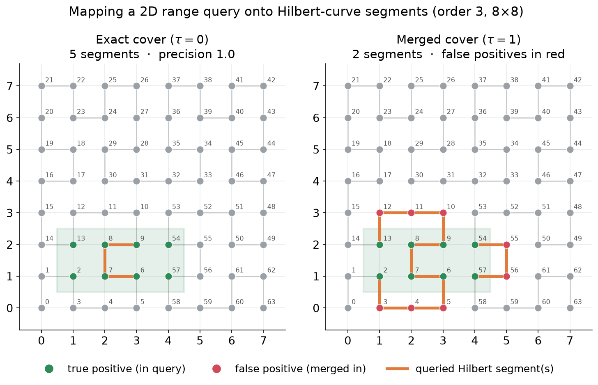

# ERS — Range Search on Encrypted Multi-Attribute Data

Experiment code for range search over encrypted multi-attribute (multi-dimensional) data.
The repository is a dimension-generic re-implementation of the schemes of
Falzon, Markatou, Espiritu and Tamassia, *Range Search over Encrypted Multi-Attribute Data*
(PVLDB 16(4), 2022), extended with

* **Hilbert-curve linearisation** of every scheme (a `d`-dimensional domain is mapped to the
  one-dimensional curve so that one-dimensional structures apply unchanged),
* **packed R-trees** as the range-supporting structure (Hilbert-order and Sort-Tile-Recursive packing),
* the **interactive double-index** protocol (`Logarithmic-SRC-i`) on the curve and on the native grid, and
* **data-dependent dividers** (cuts and TDAG cousin nodes placed by point mass instead of length),

plus a benchmark harness, a report site and the scripts that produce every figure of the accompanying paper.

<p align="center">
  
</p>

> This code implements cryptographic primitives for **research purposes only** and must not be used in production.

## Contents

- [Quick start](#quick-start)
- [Repository layout](#repository-layout)
- [Library usage](#library-usage)
- [The schemes](#the-schemes)
- [Architecture](#architecture)
- [Datasets](#datasets)
- [Benchmarking](#benchmarking)
- [Figures and the report site](#figures-and-the-report-site)
- [Reproducing the paper](#reproducing-the-paper)
- [Development](#development)
- [Machine-checked results](#machine-checked-results)
- [Citing](#citing)

## Quick start

Python 3.12 or newer is required (3.12–3.14 are tested).

```bash
git clone https://github.com/rosualinpetru/ers.git && cd ers
python3 -m venv .venv && source .venv/bin/activate
pip install -e ".[dev]"          # library + harness + pytest/ruff/pyright

pytest                            # the whole suite (~1 min)
python3 -m ers.benchmark.cli --scheme range_brc --dataset cali \
        --domain-size 6 --records-limit 1000000 --queries-count 250
python3 -m ers.benchmark.plot.plot_benchmarks benchmarks   # http://127.0.0.1:8050
```

## Repository layout

```
ers/
  structures/      HyperRange, Point, HyperRangeTree (range-supporting DAG), HyperRangeTreeProduct,
                   HilbertCurve (segment decomposition), PackedRTree / HilbertRTree / STRRTree
  util/hyperrange/ dividers: uniform, mid-overlap (TDAG), data-dependent, data-dependent mid-overlap
  util/crypto/     SHA-512 / HMAC / HKDF / AES-CBC wrappers      util/serialization/  JSON labels
  schemes/
    common/        EMMEngine (the encrypted multi-map), EMM base, StructuredScheme (+ cover rules),
                   structure_builders, PackedRTreeScheme
    *.py           native schemes: linear, range_brc, tdag_src, quad_brc, quad_src, rtree_scheme
    dependent/     native data-dependent variants
    hilbert/       Hilbert variants (+ hilbert/dependent/), HilbertRTreeScheme, InteractiveSRCHilbert
    interactive/   InteractiveSRC (1-D protocol) and InteractiveSRCNative
  benchmark/       cli.py (scheme registry + entry point), benchmark.py (harness), util/ (datasets,
                   queries, xlsx), plot/plot_benchmarks.py (Dash report site)
scripts/           per-dataset benchmark wrappers, run_all.sh, figure generators, Hilbert inspector
tests/             pytest suite (brute-force-validated correctness for every registered scheme)
data/              cali, spitz, gowalla, nh_64 (gzipped)        queries/   cached query workloads
benchmarks/        .xlsx reports (one per scheme × dataset × domain)   docs/   findings + images
```

## Library usage

Every scheme follows the same five-step protocol: `setup`, `build_index`, `trapdoor`, `search`, `resolve`.

```python
from ers.schemes.common.emm_engine import EMMEngine
from ers.schemes.range_brc import RangeBRC
from ers.structures.hyperrange import HyperRange
from ers.structures.point import Point

bits = [6, 6]                                   # a 64 x 64 domain
scheme = RangeBRC(EMMEngine(bits, dimensions=2))
key = scheme.setup(16)                          # 16-byte master key

records = {Point([3, 7]): [b"doc-1", b"doc-2"], Point([40, 41]): [b"doc-3"]}
scheme.build_index(key, records)                # client -> server: scheme.encrypted_db

query = HyperRange.from_coords([0, 0], [10, 10])
tokens = scheme.trapdoor(key, query)            # client -> server
encrypted = scheme.search(tokens)               # server
print(scheme.resolve(key, encrypted))           # {b'doc-1', b'doc-2'}
print(len(tokens), scheme.exact)                # cover size; True for exact schemes
```

The Hilbert BRC schemes accept a `merging_tolerance` argument in `trapdoor` (0 = exact cover).
The two-round interactive schemes expose the rounds separately and a convenience driver:

```python
from ers.schemes.hilbert.interactive_src_hilbert import InteractiveSRCHilbert

scheme = InteractiveSRCHilbert(EMMEngine(bits, 2), single_range_cover_round2=True)
key = scheme.setup(16)
scheme.build_index(key, records)                # builds index1 (value domain) and index2 (documents)
documents, metrics = scheme.query_with_metrics(key, query)   # runs both rounds, reports tokens per round
```

## The schemes

Every scheme is one cell of a four-axis design space: **structure** × **cover rule** ×
**domain** (native grid or Hilbert curve) × **divider** (uniform or data-dependent).
The CLI name is the key of the registry in [`ers/benchmark/cli.py`](ers/benchmark/cli.py).

| Structure + cover | Native, uniform | Native, data-dependent | Hilbert, uniform | Hilbert, data-dependent | Exact? |
|---|---|---|---|---|---|
| Linear (no structure) | `linear` | — | `linear_hilbert` | — | yes |
| Range tree product + BRC | `range_brc` | `range_brc_data_dependent` | `range_brc_hilbert` | `range_brc_hilbert_data_dependent` | yes |
| TDAG product + SRC | `tdag_src` | `tdag_src_data_dependent` | `tdag_src_hilbert` | `tdag_src_hilbert_data_dependent` | no (1 token) |
| Quadtree + BRC | `quad_brc` | `quad_brc_data_dependent` | `quad_brc_hilbert` | `quad_brc_hilbert_data_dependent` | yes |
| Quadtree + SRC | `quad_src` | `quad_src_data_dependent` | `quad_src_hilbert` | `quad_src_hilbert_data_dependent` | no (1 token) |
| Packed R-tree | `rtree` (STR) | inherent | `hilbert_rtree` | inherent | no |
| Interactive double index (2 rounds) | `interactive_src` | — | `interactive_src_hilbert` | — | SRC round 2: no; BRC round 2: yes |

*BRC* = Best Range Cover (minimal set of nodes tiling the query exactly; one token per node).
*SRC* = Single Range Cover (the one smallest node containing the query; one token, false positives).
A packed R-tree is data-dependent by construction; the linear scheme has no structure to adapt.

Every data-dependent scheme also has a `*_records` variant (e.g. `range_brc_data_dependent_records`) whose
divider balances records instead of occupied cells. Class names mirror the CLI names
(`RangeBRCHilbertDataDependent`, `RangeBRCHilbertDataDependentRecords`, `TdagSRC`, `HilbertRTreeScheme`, …).

## Architecture

* **`EMMEngine`** ([`emm_engine.py`](ers/schemes/common/emm_engine.py)) is the encrypted multi-map:
  label → HMAC token; the `i`-th value of a label lives at `Hash(token ‖ i)`, AES-CBC encrypted.
  Every scheme reduces to "which labels is a point indexed under, and which labels does a query ask for".
* **`StructuredScheme`** ([`structured_scheme.py`](ers/schemes/common/structured_scheme.py)) implements
  the protocol once for *structure + cover rule* schemes. A concrete scheme overrides `_build_structure`
  (see [`structure_builders.py`](ers/schemes/common/structure_builders.py)) and inherits its cover rule
  from `BestRangeCover` or `SingleRangeCover`; `HilbertScheme` adds the projection onto the curve and the
  segment decomposition of queries.
* **`HyperRangeTree`** ([`hyperrange_tree.py`](ers/structures/hyperrange_tree.py)) is the generic
  range-supporting structure (Definition 4 of Falzon et al.): a DAG of canonical ranges produced by a
  **divider**. Identical ranges are built once and shared, which is what makes the mid-overlap divider
  produce a true TDAG. `HyperRangeTreeProduct` is the product of per-dimension trees.
* **Dividers** ([`ers/util/hyperrange/`](ers/util/hyperrange/)) decide how a range splits: by length
  (`UniformSplitDivider`), by length with seam-straddling cousins (`UniformSplitMidOverlapDivider`, the TDAG),
  by mass (`DataDependentSplitDivider`), or by mass with mass-centred cousins
  (`DataDependentSplitMidOverlapDivider`). Mass is counted in occupied cells by default (`weight="cells"`,
  the benchmarked setting, which reduces to the uniform cut on fully occupied domains) or in records
  (`weight="records"`). Per-dimension trees receive the data projected on their own axis.
* **`HilbertCurve`** ([`hilbert_curve.py`](ers/structures/hilbert_curve.py)) maps points to curve distances
  and decomposes a query box into the contiguous curve *segments* covering it, with Moten's empirical
  segment merging (`brc_with_merging`) and the single `[min, max]` interval (`src`).
* **`PackedRTree`** ([`packed_rtree.py`](ers/structures/packed_rtree.py)) is the shared bulk-loaded R-tree
  (node type, level packing, cover); `HilbertRTree` and `STRRTree` only supply the leaf order.
  `PackedRTreeScheme` labels nodes by deterministic id, never by bounding box.
* **`InteractiveSRC`** ([`interactive_src.py`](ers/schemes/interactive/interactive_src.py)) is the two-round
  `Logarithmic-SRC-i` protocol written over an abstract 1-D value domain; the Hilbert variant orders
  documents by curve distance, the native variant by lexicographic rank with a product-TDAG first round.

## Datasets

| Name | Dim. | Records | Source | Notes |
|---|---|---|---|---|
| `cali` | 2 | 21,047 | California road-network intersections | min–max scaled to a `2^b × 2^b` grid |
| `spitz` | 2 | 28,837 | phone locations of Malte Spitz, 2009–2010 | idem |
| `gowalla` | 2 | 6,442,892 | Gowalla check-ins, 2009–2010 | idem; very slow |
| `nh_64` | 3 | 4,096 | USGS elevation, White Mountains (NH) | fixed `2^6` per dimension |
| `dense_2d`, `dense_3d` | 2, 3 | up to the limit | synthetic, evenly sampled grid | worst case: every cell populated |
| `random_2d` | 2 | the limit | synthetic, uniform random | |

Loaders are in [`dataset_generator.py`](ers/benchmark/util/dataset_generator.py); `--domain-size b`
is the per-dimension bit length the real datasets are scaled to.

## Benchmarking

```bash
python3 -m ers.benchmark.cli --scheme <name> --dataset <dataset> --domain-size <bits> \
        --records-limit <n> --queries-count <q>
```

* The harness ([`benchmark.py`](ers/benchmark/benchmark.py)) builds the index, then runs `q` queries
  split evenly over **ten selectivity buckets** (query area as 0–10 %, 10–20 %, … of the domain).
  Queries are generated once per `(dimensions, bits)` and cached in `queries/`, so every scheme
  sees the same workload.
* Reports land in `benchmarks/` as
  `<scheme>_<dataset>_<dims>_<bits>_<records>_<queries>_<timestamp>.xlsx`, one sheet per metric,
  one row `(bucket, mean)` per bucket. Metrics: `index_time`, `index_size` (a `sys.getsizeof` byte
  proxy, the same formula for every scheme), `trapdoor_time`, `trapdoor_size`, `trapdoor_count`,
  `search_time`, `search_count`, `resolve_time`, `precision` (plus `trapdoor_count_round1/2`,
  `filter_time` and `rounds` for the interactive schemes).
* `precision` is measured only for schemes with `exact = False`; exact schemes record the sentinel
  `-1` ("1.0 by construction") and a false negative records `-inf` (it never happens: the test suite
  pins it, but the harness checks anyway).
* Queries of a run execute in a process pool, so **wall-clock metrics are contention-affected**;
  token counts, result counts, precision and index size are deterministic.

Per-dataset wrappers sweep sensible domain sizes and validate the scheme name against the registry:

```bash
scripts/cali.sh range_brc            # also: spitz.sh, gowalla.sh, nh.sh, dense_2d.sh, dense_3d.sh
scripts/run_all.sh cali              # every registered scheme, or: scripts/run_all.sh cali rtree quad_brc
QUERIES_COUNT=20 PYTHON=python3 scripts/spitz.sh hilbert_rtree    # environment overrides
```

Scale notes: the Hilbert TDAG schemes build a structure over the whole `2^(d·b)` curve domain, and the
Linear schemes issue one token per query cell, so both become slow on large domains (the 3D `nh_64`
curve domain has `2^18` cells). Data-dependent dividers can build deep trees on clustered data; the CLI
raises the recursion limit accordingly.

## Figures and the report site

* [`scripts/gen_report_figures.py`](scripts/gen_report_figures.py) reads `benchmarks/` and writes every
  figure and LaTeX table of the paper's evaluation (PDF + PNG + `summary.csv`) to `figures/report/`.
* [`scripts/gen_figures.py`](scripts/gen_figures.py) and
  [`scripts/gen_future_figures.py`](scripts/gen_future_figures.py) run the schemes directly on small
  synthetic data for the illustrative figures (Hilbert curve, segment merging, the extension sketches).
* [`scripts/plot_hilbert.py`](scripts/plot_hilbert.py) draws one query's cover on the curve (debugging aid).
* `python3 -m ers.benchmark.plot.plot_benchmarks benchmarks` serves a four-page Dash site (overview and
  metric reference, scheme guide, interactive explorer, coverage of loaded reports). In both the site and the
  static figures: hue = scheme family; marker = domain and divider (native: circle / diamond / square for
  uniform / cell-balanced / record-balanced, Hilbert: triangle-up / triangle-down / X); Hilbert lines are also dashed.

* [`scripts/validate_reports.py`](scripts/validate_reports.py) checks every report against its scheme's
  contract (single covers issue one token, exact schemes agree on result counts, the quadtree/Hilbert
  equivalences hold to the byte, index sizes are ordered, no false negatives) and, with
  `--replay <dataset> <bits>`, rebuilds every scheme on the real data and reproduces the report per query.

A written summary of what the benchmarks show is in
[`docs/BENCHMARK_FINDINGS.md`](docs/BENCHMARK_FINDINGS.md).

## Reproducing the paper

```bash
for ds in dense_2d cali spitz nh; do QUERIES_COUNT=20 scripts/run_all.sh $ds; done   # hours
python3 scripts/validate_reports.py --replay dense_2d 4 --replay cali 5
python3 scripts/gen_report_figures.py --out figures/report
```

The committed reports were produced with 20 queries per (dataset, domain) at domains `2^6`–`2^10`
(`dense_2d`), `2^10`–`2^14` (`cali`, `spitz`) and `2^18` (`nh_64`); the wrappers sweep wider ranges.

## Development

* **Tests** — `pytest`. Every registered scheme is checked end-to-end in 2D and 3D against a brute-force
  ground truth (no false negatives; exactness where declared; one token for SRC schemes), plus divider
  invariants, the Hilbert segment cover, R-tree packing, the interactive protocol and the EMM engine.
* **Lint, format, types** — `ruff check ers tests scripts`, `ruff format ers tests scripts`,
  `pyright ers tests scripts` (configured in [`pyproject.toml`](pyproject.toml); all three pass clean).
* **Adding a scheme** — subclass `BestRangeCover` / `SingleRangeCover` (or their Hilbert counterparts)
  and implement `_build_structure`; set `exact` if the cover rule is custom; register the class in
  `ers.benchmark.cli.schemes`. `tests/test_registry.py` picks it up automatically.
* See [`CHANGELOG.md`](CHANGELOG.md) for the history, including two measurement bugs fixed in 1.2.0
  that affect how earlier reports should be read.

## Machine-checked results

The paper's propositions and lemmas are formalised in Lean 4 under [`lean/`](lean/) (core library only):

| Module | What it proves |
|---|---|
| [`Ers/Segments.lean`](lean/Ers/Segments.lean) | The segment decomposition (Algorithm 1 at tolerance 0) returns exactly the maximal runs of a query: sound, maximal, complete, at most one segment per boundary cell; the linear scheme's token set equals the query's distance set. |
| [`Ers/Geometry.lean`](lean/Ers/Geometry.lean) | The hypotheses of the segment lemma are *derived* from geometry: for any curve whose consecutive cells are grid-adjacent and which starts and ends on faces of the domain, the boundary cells of any box satisfy them (so the lemma holds for the real curves with no unproved hypothesis). |
| [`Ers/Quad.lean`](lean/Ers/Quad.lean) | Quadtree equivalence under the Hilbert sub-cube property (SRC and BRC containment transfer, maximality transfer via segments) plus `decide`-checked adjacency, sub-cube alignment and bijectivity of the actual curves at orders 2–3 (2D) and 2 (3D). |
| [`Ers/RangeTree.lean`](lean/Ers/RangeTree.lean) | The curve tree's canonical ranges are a strict subset of the product tree's (counterexample box + checked inclusion). |
| [`Ers/Divider.lean`](lean/Ers/Divider.lean) | Any divider with strictly shorter, covering children terminates; depth ≤ domain size; every cell is a leaf; the single range cover returns exactly one, shortest, containing vertex. The uniform divider is shown to satisfy the hypotheses (non-vacuity). |

```bash
curl -sSf https://elan.lean-lang.org/elan-init.sh | sh -s -- -y   # once: the Lean toolchain manager
cd lean && lake build                                                # ~10 s
```

`Ers/CurveData.lean` holds the curve tables exported from the `hilbertcurve` package the schemes use, and
`tests/test_lean_agreement.py` pins the Lean model to the implementation: the Lean segment rule reproduces
`HilbertCurve.brc_with_merging(q, 0)` on random boxes, and the implemented dividers satisfy `Divider.Good`.

## Citing

The original framework and schemes:

```bibtex
@article{falzon2022range,
  author  = {Francesca Falzon and Evangelia Anna Markatou and Zachary Espiritu and Roberto Tamassia},
  title   = {Range Search over Encrypted Multi-Attribute Data},
  journal = {Proc. VLDB Endow.},
  volume  = {16}, number = {4}, pages = {587--600}, year = {2022},
  doi     = {10.14778/3574245.3574247}
}
```

This repository is a fork of [cloudsecuritygroup/ers](https://github.com/cloudsecuritygroup/ers).
All code is provided as-is under the Apache License 2.0; see [`LICENSE`](LICENSE).
